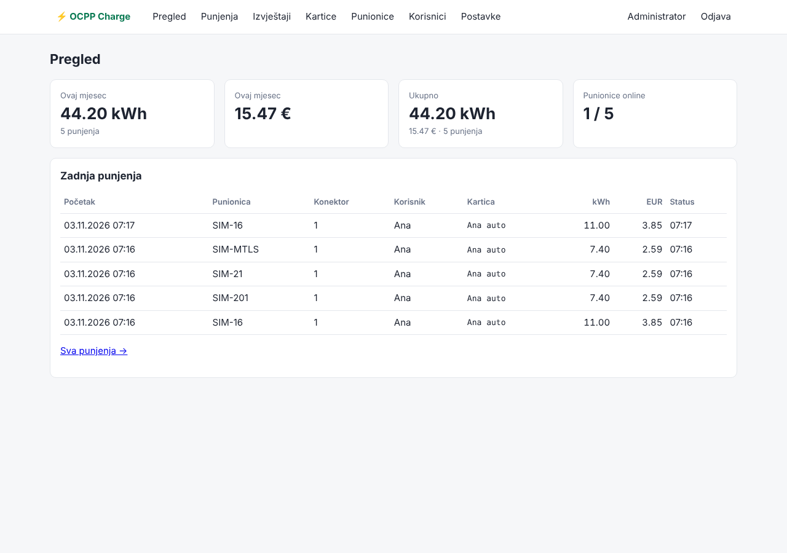

# ⚡ OCPP Charge

Jednostavan sustav za upravljanje punionicama električnih vozila (CSMS / Central System).



## Što zna

| Područje | Podrška |
|---|---|
| **OCPP verzije** | 1.6J (uklj. *Security Extension*), 2.0.1, 2.1. Verzija se automatski dogovara sa svakom punionicom (WebSocket subprotocol). |
| **Sigurnosni profili** | 0 (samo test), 1 (Basic Auth), 2 (TLS + Basic Auth), 3 (obostrani TLS, klijentski certifikat s CN = ID punionice). Profil se zadaje po punionici i server ga provodi pri spajanju. |
| **TLS** | TLS 1.2+, preporučeni OCPP cipher suiteovi. Ugrađeni CA ili vlastiti certifikat (npr. Let's Encrypt). |
| **Certifikati** | `SignCertificate` / `CertificateSigned` (CSMS potpisuje CSR punionice), `InstallCertificate` (CA na punionicu), `ExtendedTriggerMessage`/`TriggerMessage` za pokretanje obnove. |
| **Lozinke punionica** | Generiraju se nasumično, spremaju samo kao bcrypt hash, rotacija gumbom (nova lozinka se prvo pošalje punionici, tek onda spremi). |
| **RFID** | Kartice dodijeljene korisnicima, blokiranje, istek. UID se normalizira (velika slova, bez razmaka/dvotočki) jer različiti čitači šalju različito. Nepoznate kartice se bilježe u događaje. |
| **Korisnici** | Prijava e-mail + lozinka + MFA (TOTP: Google/Microsoft Authenticator, 1Password…), zaključavanje nakon 5 neuspjelih pokušaja, CSRF zaštita, sigurnosna HTTP zaglavlja. Uloge: administrator i korisnik (korisnik vidi samo svoju potrošnju). |
| **Potrošnja** | kWh i EUR po punjenju, korisniku i kartici, filter po datumu, CSV izvoz (Excel-friendly). Cijena je globalna ili po punionici i zaključava se na početku punjenja. Uživo snaga i kWh dok punjenje traje. |
| **Upravljanje** | Daljinski start/stop, soft/hard reset, otključavanje konektora, odobravanje novih punionica, dnevnik događaja (uklj. `SecurityEventNotification`). |

### Proizvođači

Svi navedeni proizvođači koriste standardni OCPP, pa sustav radi s njima bez posebnog koda. Za svakog postoji profil s uputama u sučelju i preporučenim postavkama koje se šalju nakon spajanja:

| Proizvođač | Tipični modeli | OCPP |
|---|---|---|
| Gewiss | JOINON I-CON, Easy, Pro | 1.6J |
| Schneider Electric | EVlink Pro AC/DC, Smart Wallbox | 1.6J (2.0.1 na novijim) |
| SMA | EV Charger Business | 1.6J |
| Huawei | SCharger / FusionCharge AC | 1.6J |
| Fronius | Wattpilot | 1.6J |

> ⚠️ Kompatibilnost je testirana simulatorom prema OCPP specifikaciji, **ne na stvarnim uređajima**. Prije produkcije spoji po jedan uređaj svakog proizvođača i provjeri: spajanje, autorizaciju karticom, start/stop i mjerenja. Ako neki uređaj odstupa, to se rješava u `csms/vendors.py`.

## Pokretanje

📘 **Detaljne upute korak po korak (server, HTTPS, prva proba, spajanje punionica, backup): [docs/INSTALACIJA.md](docs/INSTALACIJA.md)**

### Server (produkcija, automatski HTTPS)

```bash
cp .env.example .env      # popuni lozinke, tajni ključ, domenu
docker compose -f docker-compose.prod.yml up -d --build
```

Caddy nabavlja Let's Encrypt certifikat. Web sučelje i OCPP rade na `https://<domena>` i `wss://<domena>/ocpp/<ID>`.

### Lokalna proba

```bash
cp .env.example .env      # CSMS_PUBLIC_HOSTNAME=localhost
docker compose up -d --build
```

Web sučelje: `http://localhost:8000`, OCPP: `ws://localhost:9000/ocpp/<ID>` i `wss://localhost:9443/ocpp/<ID>` (ugrađeni CA).

### Lokalno (razvoj)

```bash
python -m venv .venv && source .venv/bin/activate
pip install -r requirements.txt
python -m csms.main
```

## Spajanje punionice

1. **Punionice → Dodaj punionicu**: upiši Charge Point ID, odaberi proizvođača i sigurnosni profil. Sustav prikaže lozinku (samo jednom).
2. U punionici (aplikacija ili web sučelje proizvođača) upiši:
   - URL: `wss://<tvoj-host>:9443/ocpp/` (profil 2/3) ili `ws://<tvoj-host>:9000/ocpp/` (profil 1). Neki uređaji traže cijeli URL s ID-em na kraju: `.../ocpp/<ID>`.
   - Charge Point ID: isti kao u sustavu
   - Lozinka / Authorization Key: generirana lozinka
3. Ako koristiš ugrađeni CA za wss, na punionicu instaliraj CA certifikat (**Postavke → Preuzmi CA certifikat**, ili gumb *Instaliraj CA certifikat* dok je punionica spojena na profilu 1). Ako koristiš Let's Encrypt certifikat, to obično nije potrebno.

Nepoznata punionica koja se spoji automatski se pojavi kao *čeka odobrenje*. Admin je odobri, postavi profil i generira lozinku.

### Prelazak na sigurnosni profil 3 (mTLS)

1. Punionica radi na profilu 2.
2. *Instaliraj CA certifikat*, pa *Zatraži certifikat (CSR)*. Punionica šalje CSR (CN mora biti njen ID), sustav ga potpisuje i šalje natrag (`certificate_signed` u događajima).
3. U postavkama punionice odaberi profil 3, pa (1.6J) *Pošalji SecurityProfile* ili (2.x) promijeni NetworkConnectionProfile na punionici.

## RFID kartice i korisnici

- **Korisnici**: dodaj korisnika, a on se prijavi i uključi MFA u *Moj račun*. Admin može resetirati MFA i otključati račun.
- **Kartice**: upiši UID (npr. `04A1B2C3D4`) i dodijeli korisniku. UID nepoznate kartice vidiš u *Postavke → Događaji* nakon što je netko prisloni na punionicu.
- Korisnik u sučelju vidi samo svoja punjenja, kartice i potrošnju.

## Testiranje

```bash
pip install pytest httpx
pytest -q
```

Testovi pokreću pravi OCPP server i simulator punionice za 1.6J, 2.0.1 i 2.1, uz sigurnosne profile 1, 2 i 3, te provjeravaju prijavu s MFA, CSRF i izolaciju korisnika.

Simulator možeš koristiti i ručno:

```bash
python tools/simulator.py --id SIM-01 --password <lozinka> --tag 04A1B2C3D4
python tools/simulator.py --version 2.0.1 --url wss://localhost:9443/ocpp --ca data/pki/ca.crt --id SIM-01 --password <lozinka>
python tools/simulator.py --id SIM-01 --password <lozinka> --stay   # ostaje spojen, pa probaj daljinski start iz sučelja
```

## Arhitektura

```
csms/
  main.py          pokretanje (web + OCPP u istoj asyncio petlji)
  ocpp_server.py   WebSocket serveri ws/wss, dogovor verzije, provjera sigurnosnog profila
  handlers/v16.py  OCPP 1.6J poruke i naredbe
  handlers/v2x.py  OCPP 2.0.1 i 2.1 poruke i naredbe
  services.py      autorizacija kartica, transakcije, mjerenja, cijena
  security.py      lozinke, TOTP, ugrađeni CA, TLS kontekst
  vendors.py       profili proizvođača
  web.py           web sučelje (FastAPI + Jinja)
  db.py            modeli (SQLAlchemy, SQLite; za PostgreSQL postavi CSMS_DATABASE_URL)
tools/simulator.py simulator punionice
```

Portovi: `8000` web, `9000` OCPP ws, `9443` OCPP wss.

## Sljedeći koraci (izvan MVP-a)

- Mobilna aplikacija / REST API za korisnike (trenutno je web sučelje prilagođeno mobitelu)
- Lokalna lista autorizacije (`SendLocalList`) za rad punionica bez interneta
- Pametno punjenje (`SetChargingProfile`, load balancing, integracija s FV elektranom: SMA, Huawei, Fronius)
- Ažuriranje firmwarea, ISO 15118 Plug & Charge, OCPI roaming
- PostgreSQL i backup za produkciju
